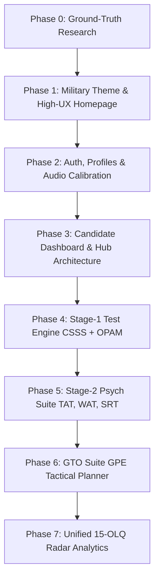

# WHITEPAPER.md — SSB Astra: Comprehensive Officer Preparation Platform

> **Document Classification:** Master Project Whitepaper & Architecture Specification  
> **Platform Name:** SSB ASTRA  
> **Insignia:** Indian Army-inspired Crossed Swords with Golden Crest Hub  
> **Scope:** Full-Spectrum SSB Preparation (Stage-1 Computerised Screening CSSS + OPAM, Stage-2 Psychological Testing TAT/WAT/SRT/SD, GTO Tactical Planning GPE/PGT, and Interview Drills)  
> **Last Updated:** Brand Pivot to "SSB Astra" & Expanded Multi-Test Scope

---

## 1. Executive Summary & Vision

### 1.1 Beyond Single-Test Screening
While initial development focused on the critical, cutting-edge **Computerised Stage-1 Screening (CSSS & OPAM)** introduced by **DIPR (DRDO)**, **SSB ASTRA** is conceived as the **definitive, all-in-one preparation ecosystem** for Indian Armed Forces officer aspirants (Army, Navy, Air Force).

### 1.2 Full-Spectrum SSB Architecture
Aspirants require comprehensive, cross-disciplinary preparation covering the full 5-day assessment pipeline:
1. **Stage-1 Screening Battery:**
   * **CSSS (Computerised Stage-1 Selection System):** ~70 timed cognitive items (Working memory, space and form perception, auditory discrimination, perceptual speed, verbal reasoning).
   * **OPAM (Objective Personality Assessment Measure):** ~120 psychometric items mapping the 15 OLQs with consistency & Lie/Social Desirability checks.
   * **Legacy / Transition Module:** Traditional OIR paper booklet simulations + PPDT picture perception and story timing.
2. **Stage-2 Psychological Series (Manso Vacha):**
   * **TAT (Thematic Apperception Test):** 11 ambiguous slides + 1 blank slide (4 minutes per story).
   * **WAT (Word Association Test):** 60 rapid-fire words (15 seconds per word).
   * **SRT (Situation Reaction Test):** 60 practical life/military dilemmas (30 minutes).
   * **SD (Self-Description Test):** 5-paragraph reflective self-assessment (Parents, Teachers, Friends, Self, Goals).
3. **Stage-2 GTO Ground Series (Karmana):**
   * **GPE (Group Planning Exercise):** Tactical situation maps, scale calculations, multi-priority crisis response, and plan drafting.
   * **PGT / HGT / Command Task Theory:** Mechanics of cantilever, fulcrum, tying rope, and bridging techniques.
   * **Lecturette & GD Topics:** Current defense & geopolitical intelligence feeds.
4. **Stage-2 Interview & OLQ Profiling:**
   * PIQ (Personal Information Questionnaire) analyzer.
   * Comprehensive 15-Factor OLQ Radar mapping across all performance metrics.

---

## 2. Technology Stack & Design System

### 2.1 Core Technologies
* **Framework:** Next.js 16+ (App Router, Turbopack, React 19, TypeScript)
* **Styling & HUD Design:** Tailwind CSS v4, Lucide React (military/tactical iconography)
* **Motion & Animation:** Framer Motion (vector line scroll drawing, HUD card reveals)
* **Audio Synthesis Engine:** Native Web Audio API (real-time sine-wave frequency generation and acoustic callouts)
* **Backend, Database & Auth (Phase 2):** Supabase (PostgreSQL with Row Level Security, session auth, question bank schema)
* **Hosting & Edge Delivery:** Vercel

### 2.2 Dual-Military Aesthetic (Tri-Services Palette)
To reflect the heritage of the Indian Armed Forces, the user interface supports a dual military design system:
* **Light Mode — Indian Air Force & Navy:**
  * Canvas: Aerodrome whites and high-altitude sky (`#F8FAFC`, `#F1F5F9`)
  * Accents: Air Force Azure & Cockpit Blue (`#0284C7`), Deep Naval Blue (`#0F172A`), Golden Crest highlights (`#D97706`)
* **Dark Mode — Indian Army & Tactical Field Ops:**
  * Canvas: Camo night-black & bivouac charcoal (`#0B0F0A`, `#131911`, `#192217`)
  * Accents: Combat Military Olive (`#4D7C0F`, `#65A30D`), Desert Field Tan (`#CA8A04`, `#EAB308`), Night-vision amber HUD alerts

---

## 3. Product Roadmap & Implementation Status

### Phase Tracker:
- [x] **Phase 0: Ground-Truth Research & Protocol Mapping**
  - Mapped DIPR CSSS & OPAM constraints (per-question timers, audio discrimination, Lie scales, no-backtracking rule).
- [x] **Phase 1: Military Theme, Branding & High-UX Homepage (COMPLETED & REFINED)**
  - Rebranded to **SSB ASTRA** with authentic Indian Army straight crossed broadswords (hilts at the bottom, straight double-edged blades pointing upward and outward in saltire).
  - Web UI: Clean, transparent background featuring bare-metal gold faceted blades, crisp center spine ridge, straight crossguards with ball finials, and round pommels.
  - App Icon & Favicon Suite: Regimental Indian Army Crimson Red background with golden crossed swords and border, generated across all formats:
    - Android PWA: `/icon-192.png` & `/icon-512.png`
    - iOS Home Screen: `/apple-touch-icon.png` (180x180)
    - Browser & Vercel Tab: `favicon.ico`, `favicon-32x32.png`, `favicon-16x16.png`
  - Web App Manifest configured (`public/manifest.json`).
  - Dual military theme switcher (Air Force Blue Light / Olive Army Dark).
  - Cleaned tags and layout fitted cleanly within viewports.
- [x] **Phase 2: Authentication & Candidate Onboarding (COMPLETED & VERIFIED)**
  - Single Smart Login / Signup flow implemented (`/login`).
  - Supabase PostgreSQL schema executed via `supabase/001_candidate_profiles_and_otp.sql`.
  - Resend API key configured for live email OTP dispatch (`onboarding@resend.dev` / `onboarding@ssbastra.in`).
  - Live Supabase connection configured & verified:
    - User identity check (`/api/auth/check-email`) $\rightarrow$ identifies new vs existing aspirants.
    - 6-digit OTP verification (`/api/auth/verify-otp`) $\rightarrow$ verified against database table `email_otps`.
    - Fast onboarding registration (`/api/auth/complete-onboarding`) $\rightarrow$ provisions `auth.users` and `profiles` dossier.
  - Candidate Dashboard (`/dashboard`) live with dynamic profile data and **30% Profile Completion Bar**.
  - Serial order SQL migrations saved as raw runnable files: `supabase/001_candidate_profiles_and_otp.sql`.
- [ ] **Phase 3: Candidate Dashboard & Full Training Hub Expansion**
  - Modular selector: Stage-1 Screening Hub vs Stage-2 Psychological Lab vs GTO Tactical Simulator.
  - Readiness Index & OLQ diagnostic preview.
- [ ] **Phase 4: Stage-1 Test Engine (CSSS + OPAM)**
  - Micro-timer runner (16-30s auto-advancing, no back button).
  - Web Audio API integration for tone and phonetic callouts.
  - OPAM Likert & Situational question runner with cross-validation pair tracking.
- [ ] **Phase 5: Stage-2 Psychology Suite (TAT, WAT, SRT, SD)**
  - Slide projection timers, auto-advancing WAT words, SRT response recorder.
- [ ] **Phase 6: GTO Tactical Planning (GPE)**
  - Interactive map scenarios, resources, constraints, and plan submission.
- [ ] **Phase 7: Scoring & Composite 15-OLQ Intelligence Engine**

---

## 4. Engineering Standards & Conventions
1. **Component Modularity:** UI presentation, state machines, and audio synthesizers are decoupled in `src/components/` and `src/lib/`.
2. **Deterministic Data:** Question schemas must store factor tags, target duration, audio frequency parameters, and paired consistency IDs.
3. **Responsive Simulation:** Desktop-first for faithful terminal reproduction, with complete mobile adaptation for drill preparation.
