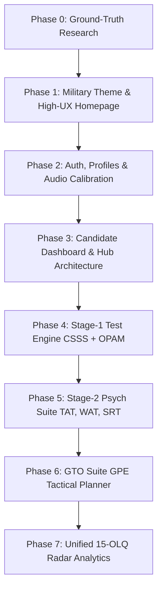

# WHITEPAPER.md — SSB Astra: Comprehensive Officer Preparation Platform

> **Document Classification:** Master Project Whitepaper & Architecture Specification  
> **Platform Name:** SSB ASTRA  
> **Insignia:** Indian Army-inspired Crossed Swords with Golden Crest Hub  
> **Scope:** Full-Spectrum SSB Preparation (Stage-1 Computerised Screening CSSS + OPAM, Stage-2 Psychological Testing TAT/WAT/SRT/SD, GTO Tactical Planning GPE/PGT, and Interview Drills)  
> **Last Updated:** Brand Pivot to "SSB Astra" & Expanded Multi-Test Scope

---

## 1. Executive Summary & Vision

### 1.1 Beyond Single-Test Screening
While initial development focused on the critical, cutting-edge **Computerised Stage-1 Screening (CSSS & OPAM)** introduced by **DIPR (DRDO)**, **SSB ASTRA** is conceived as the **definitive, all-in-one preparation ecosystem** for Indian Armed Forces officer aspirants (Army, Navy, Air Force).

### 1.2 Full-Spectrum SSB Architecture
Aspirants require comprehensive, cross-disciplinary preparation covering the full 5-day assessment pipeline:
1. **Stage-1 Screening Battery:**
   * **CSSS (Computerised Stage-1 Selection System):** ~70 timed cognitive items (Working memory, space and form perception, auditory discrimination, perceptual speed, verbal reasoning).
   * **OPAM (Objective Personality Assessment Measure):** ~120 psychometric items mapping the 15 OLQs with consistency & Lie/Social Desirability checks.
   * **Legacy / Transition Module:** Traditional OIR paper booklet simulations + PPDT picture perception and story timing.
2. **Stage-2 Psychological Series (Manso Vacha):**
   * **TAT (Thematic Apperception Test):** 11 ambiguous slides + 1 blank slide (4 minutes per story).
   * **WAT (Word Association Test):** 60 rapid-fire words (15 seconds per word).
   * **SRT (Situation Reaction Test):** 60 practical life/military dilemmas (30 minutes).
   * **SD (Self-Description Test):** 5-paragraph reflective self-assessment (Parents, Teachers, Friends, Self, Goals).
3. **Stage-2 GTO Ground Series (Karmana):**
   * **GPE (Group Planning Exercise):** Tactical situation maps, scale calculations, multi-priority crisis response, and plan drafting.
   * **PGT / HGT / Command Task Theory:** Mechanics of cantilever, fulcrum, tying rope, and bridging techniques.
   * **Lecturette & GD Topics:** Current defense & geopolitical intelligence feeds.
4. **Stage-2 Interview & OLQ Profiling:**
   * PIQ (Personal Information Questionnaire) analyzer.
   * Comprehensive 15-Factor OLQ Radar mapping across all performance metrics.

---

## 2. Technology Stack & Design System

### 2.1 Core Technologies
* **Framework:** Next.js 16+ (App Router, Turbopack, React 19, TypeScript)
* **Styling & HUD Design:** Tailwind CSS v4, Lucide React (military/tactical iconography)
* **Motion & Animation:** Framer Motion (vector line scroll drawing, HUD card reveals)
* **Audio Synthesis Engine:** Native Web Audio API (real-time sine-wave frequency generation and acoustic callouts)
* **Backend, Database & Auth (Phase 2):** Supabase (PostgreSQL with Row Level Security, session auth, question bank schema)
* **Hosting & Edge Delivery:** Vercel

### 2.2 Dual-Military Aesthetic (Tri-Services Palette)
To reflect the heritage of the Indian Armed Forces, the user interface supports a dual military design system:
* **Light Mode — Indian Air Force & Navy:**
  * Canvas: Aerodrome whites and high-altitude sky (`#F8FAFC`, `#F1F5F9`)
  * Accents: Air Force Azure & Cockpit Blue (`#0284C7`), Deep Naval Blue (`#0F172A`), Golden Crest highlights (`#D97706`)
* **Dark Mode — Indian Army & Tactical Field Ops:**
  * Canvas: Camo night-black & bivouac charcoal (`#0B0F0A`, `#131911`, `#192217`)
  * Accents: Combat Military Olive (`#4D7C0F`, `#65A30D`), Desert Field Tan (`#CA8A04`, `#EAB308`), Night-vision amber HUD alerts

---

## 3. Product Roadmap & Implementation Status

### Phase Tracker:
- [x] **Phase 0: Ground-Truth Research & Protocol Mapping**
  - Mapped DIPR CSSS & OPAM constraints (per-question timers, audio discrimination, Lie scales, no-backtracking rule).
- [x] **Phase 1: Military Theme, Branding & High-UX Homepage (COMPLETED & REFINED)**
  - Rebranded to **SSB ASTRA** using the **exact Indian Army Crossed Swords** vector (isolated directly from the official military crest, omitting the Ashoka Lion Capital).
  - Web UI: Clean, transparent background featuring the authentic golden straight swords, pierced quillon guards with ball finials, and ring pommels.
  - App Icon & Favicon Suite: Regimental Indian Army Red circular field (`#CC0000`) with golden crossed swords and subtle golden rim, generated across all formats:
    - Android PWA: `/icon-192.png` & `/icon-512.png`
    - iOS Home Screen: `/apple-touch-icon.png` (180x180)
    - Browser & Vercel Tab: `favicon.ico`, `favicon-32x32.png`, `favicon-16x16.png`
  - Web App Manifest configured (`public/manifest.json`).
  - Dual military theme switcher (Air Force Blue Light / Olive Army Dark).
  - Cleaned tags and layout fitted cleanly within viewports.
- [x] **Phase 2: Authentication & Candidate Onboarding (COMPLETED & VERIFIED)**
  - Single Smart Login / Signup flow implemented (`/login`).
  - Supabase PostgreSQL schema executed via `supabase/001_candidate_profiles_and_otp.sql`.
  - Resend live transactional email delivery configured from custom domain: `SSB Astra <mails@ssbastra.in>` with device-adaptive dark/light template.
  - Resolved UI overlapping on onboarding form fields (`select` and inputs updated with `pl-10` clearance and custom chevron indicators).
  - Live Supabase connection configured & verified:
    - User identity check (`/api/auth/check-email`) $\rightarrow$ identifies new vs existing aspirants.
    - 6-digit OTP verification (`/api/auth/verify-otp`) $\rightarrow$ verified against database table `email_otps`.
    - Fast onboarding registration (`/api/auth/complete-onboarding`) $\rightarrow$ provisions `auth.users` and `profiles` dossier.
  - Candidate Dashboard (`/dashboard`) live with dynamic profile data and **30% Profile Completion Bar**.
  - Serial order SQL migrations saved as raw runnable files: `supabase/001_candidate_profiles_and_otp.sql`.
- [x] **Phase 3: Candidate Dashboard & Training Hub Architecture (COMPLETED & REFINED)**
  - Reorganized dashboard layout to professional portal standards:
    - **Header Profile Architecture:**
      - Removed dedicated external logout button from dashboard header.
      - Integrated profile dropdown menu toggled by clicking the avatar icon (contains candidate details, Edit PIQ shortcut, and Sign Out action).
      - **Extended Window State (when PIQ < 100%):** Profile icon on the far right, candidate name/meter in the middle, and **`Complete PIQ` action button on the left**.
      - **Compact State (when PIQ = 100%):** Collapses into a standalone avatar trigger on the right.
    - **Session Persistence & Smart Navigation:**
      - Homepage top bar automatically detects user session via Supabase auth state (`onAuthStateChange`).
      - Logged-in users see a direct **`Go to Dashboard`** button instead of having to log in every time.
    - Replaced static headline with dynamic military greeting engine (`getDynamicOfficerGreeting`):
      - Adapts to time of day (*Good Morning / Good Afternoon / Good Evening*).
      - Randomizes between candidate's first name, *"Future Officer"*, *"Officer Aspirant"*, or *"Cadet"*.
      - Future-ready gender architecture: When `gender` is added in PIQ completion, will automatically unlock *"Gentleman"* (male) or *"Lady"* (female).
    - Built the 3 primary selection assessment suites as prominent cards:
      1. **Screening (Day 01):** CSSS cognitive micro-timers (~70 Qs), OPAM psychometrics (~120 Qs), and legacy OIR/PPDT mode.
      2. **Psychology (Day 02):** Manso Vacha suite covering TAT (4-min slides), WAT (15s words), SRT, and SD.
      3. **GTO (Day 03 & 04):** Karmana ground series featuring GPE tactical sand models, PGT/HGT bridging physics, and Lecturette intelligence.
  - Zero build errors, fully type-checked with TypeScript and Next.js 16.
- [x] **Phase 3.5: PIQ (Personal Information Questionnaire) Analysis & AI Autofill UI (IN PROGRESS / UI BUILT)**
  - **Comprehensive DIPR Form 107-A Analysis:** Analyzed official DIPR Questionnaire No. 107-A (Revised) structure across both Page 1 and Page 2 (14 distinct items, 4 complex nested matrices: Family, Education, Sports, Previous SSB attempts).
  - **Sample Blank PIQ Delivery:** Added official DIPR 107-A blank PDF at `public/sample_piq.pdf` with direct 1-click download on candidate profile.
  - **AI Smart Extraction Backend & Image Normalization Pipeline:**
    - Configured dedicated Google Gemini API key (`GEMINI_PIQ_API_KEY`) isolated strictly for PIQ document analysis.
    - Added high-performance image pre-processing with `sharp`: auto-rotates mobile EXIF orientation (`.rotate()`), standardizes resolution to 1600px width, and normalizes into high-contrast 85% JPEG for deterministic multimodal vision processing.
    - Implemented live cascading backend endpoint `/api/piq/analyze` using **`gemini-3.5-flash-lite`** (500 free daily scans quota, ~15,000/month) with automatic failover to `gemini-3.8-flash` and `gemini-flash-latest`.
    - Native multimodal intake supporting 3 distinct acquisition flows:
      1. *2-Page PDF* (`application/pdf`)
      2. *2 Photos (Page 1 Front & Page 2 Back)* (`image/png, image/jpeg`)
      3. *Live Camera Capture* (`accept="image/*" capture="environment"`)
    - Streamlined production intake strictly driven by live AI document ingestion (2-Page PDF, 2 Photos, or Direct Camera Scan).
  - **Officer Candidate Dossier Assessment & PIQ Scoring Engine:**
    - Refined system prompt to perform dual-action processing: strict JSON transcription + Senior Interviewing Officer (IO) evaluation.
    - Evaluates candidates across the **4 Classical Assessment Pillars**:
      1. *Academics & Consistency* (25 pts)
      2. *Sports, NCC & Physical Stamina* (25 pts)
      3. *Leadership & Positions of Responsibility* (25 pts)
      4. *Hobbies, Self-Development & Drive* (25 pts)
    - Emits:
      - Composite **PIQ Score out of 100** with overall verdict badge.
      - Positive OLQ indicators (Strengths).
      - Vulnerabilities & Red Flags (areas the IO will probe).
      - **Predicted IO Rapid-Fire Questions** forecast.
      - Tactical recommendations to strengthen candidate presentation.
  - **Profile Page (`src/app/profile/page.tsx`) Deployed:**
    - Integrated the **AI PIQ Dossier Assessment & IO Forecast** visual radar component above tabs.
    - Locked email credential field (read-only with security padlock badge).
    - 4 structured military tabbed panels:
      1. *Identity & Demographics* (Items 1-3, 5: Name, Father's Name, DOB, Gender, Religion, Mother Tongue, Category, Marital Status).
      2. *Residential History* (Item 4: Maximum, Present, Permanent residence with population & District HQ toggle).
      3. *Family & Academics* (Items 6 & 7: Parents alive toggle, dynamic family members table, full 4-tier educational record table).
      4. *Physical, NCC, Sports & SSB History* (Items 8-14: Height, Weight, Occupation, NCC Wing/Div/Cert, Sports, Hobbies, Responsibilities, Commission Nature & Service Preference, Previous SSB attempts table).
    - Local storage state persistence + Supabase profile updates (saving advances completion to 100%).
    - Seamless navigation links connected from Dashboard profile menu.
  - **Next Step:** Finalize SQL schema fields with user before executing migration `supabase/002_add_piq_fields.sql`.
- [ ] **Phase 4: Stage-1 Test Engine (CSSS + OPAM)**
  - Micro-timer runner (16-30s auto-advancing, no back button).
  - Web Audio API integration for tone and phonetic callouts.
  - OPAM Likert & Situational question runner with cross-validation pair tracking.
- [ ] **Phase 5: Stage-2 Psychology Suite (TAT, WAT, SRT, SD)**
  - Slide projection timers, auto-advancing WAT words, SRT response recorder.
- [ ] **Phase 6: GTO Tactical Planning (GPE)**
  - Interactive map scenarios, resources, constraints, and plan submission.
- [ ] **Phase 7: Scoring & Composite 15-OLQ Intelligence Engine**

---

## 4. Engineering Standards & Conventions
1. **Component Modularity:** UI presentation, state machines, and audio synthesizers are decoupled in `src/components/` and `src/lib/`.
2. **Deterministic Data:** Question schemas must store factor tags, target duration, audio frequency parameters, and paired consistency IDs.
3. **Responsive Simulation:** Desktop-first for faithful terminal reproduction, with complete mobile adaptation for drill preparation.
