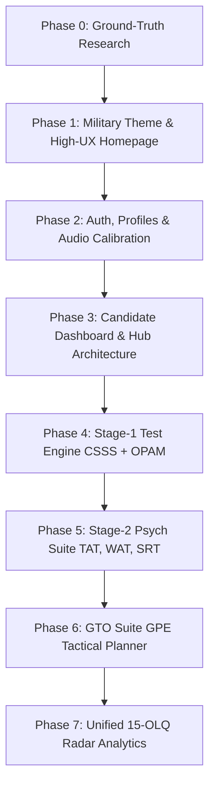

# WHITEPAPER.md — SSB Astra: Comprehensive Officer Preparation Platform

> **Document Classification:** Master Project Whitepaper & Architecture Specification  
> **Platform Name:** SSB ASTRA  
> **Insignia:** Indian Army-inspired Crossed Swords with Golden Crest Hub  
> **Scope:** Full-Spectrum SSB Preparation (Stage-1 Computerised Screening CSSS + OPAM, Stage-2 Psychological Testing TAT/WAT/SRT/SD, GTO Tactical Planning GPE/PGT, and Interview Drills)  
> **Last Updated:** Brand Pivot to "SSB Astra" & Expanded Multi-Test Scope

---

## 1. Executive Summary & Vision

### 1.1 Beyond Single-Test Screening
While initial development focused on the critical, cutting-edge **Computerised Stage-1 Screening (CSSS & OPAM)** introduced by **DIPR (DRDO)**, **SSB ASTRA** is conceived as the **definitive, all-in-one preparation ecosystem** for Indian Armed Forces officer aspirants (Army, Navy, Air Force).

### 1.2 Full-Spectrum SSB Architecture
Aspirants require comprehensive, cross-disciplinary preparation covering the full 5-day assessment pipeline:
1. **Stage-1 Screening Battery:**
   * **CSSS (Computerised Stage-1 Selection System):** ~70 timed cognitive items (Working memory, space and form perception, auditory discrimination, perceptual speed, verbal reasoning).
   * **OPAM (Objective Personality Assessment Measure):** ~120 psychometric items mapping the 15 OLQs with consistency & Lie/Social Desirability checks.
   * **Legacy / Transition Module:** Traditional OIR paper booklet simulations + PPDT picture perception and story timing.
2. **Stage-2 Psychological Series (Manso Vacha):**
   * **TAT (Thematic Apperception Test):** 11 ambiguous slides + 1 blank slide (4 minutes per story).
   * **WAT (Word Association Test):** 60 rapid-fire words (15 seconds per word).
   * **SRT (Situation Reaction Test):** 60 practical life/military dilemmas (30 minutes).
   * **SD (Self-Description Test):** 5-paragraph reflective self-assessment (Parents, Teachers, Friends, Self, Goals).
3. **Stage-2 GTO Ground Series (Karmana):**
   * **GPE (Group Planning Exercise):** Tactical situation maps, scale calculations, multi-priority crisis response, and plan drafting.
   * **PGT / HGT / Command Task Theory:** Mechanics of cantilever, fulcrum, tying rope, and bridging techniques.
   * **Lecturette & GD Topics:** Current defense & geopolitical intelligence feeds.
4. **Stage-2 Interview & OLQ Profiling:**
   * PIQ (Personal Information Questionnaire) analyzer.
   * Comprehensive 15-Factor OLQ Radar mapping across all performance metrics.

---

## 2. Technology Stack & Design System

### 2.1 Core Technologies
* **Framework:** Next.js 16+ (App Router, Turbopack, React 19, TypeScript)
* **Styling & HUD Design:** Tailwind CSS v4, Lucide React (military/tactical iconography)
* **Motion & Animation:** Framer Motion (vector line scroll drawing, HUD card reveals)
* **Audio Synthesis Engine:** Native Web Audio API (real-time sine-wave frequency generation and acoustic callouts)
* **Backend, Database & Auth (Phase 2):** Supabase (PostgreSQL with Row Level Security, session auth, question bank schema)
* **Hosting & Edge Delivery:** Vercel

### 2.2 Dual-Military Aesthetic (Tri-Services Palette)
To reflect the heritage of the Indian Armed Forces, the user interface supports a dual military design system:
* **Light Mode — Indian Air Force & Navy:**
  * Canvas: Aerodrome whites and high-altitude sky (`#F8FAFC`, `#F1F5F9`)
  * Accents: Air Force Azure & Cockpit Blue (`#0284C7`), Deep Naval Blue (`#0F172A`), Golden Crest highlights (`#D97706`)
* **Dark Mode — Indian Army & Tactical Field Ops:**
  * Canvas: Camo night-black & bivouac charcoal (`#0B0F0A`, `#131911`, `#192217`)
  * Accents: Combat Military Olive (`#4D7C0F`, `#65A30D`), Desert Field Tan (`#CA8A04`, `#EAB308`), Night-vision amber HUD alerts

---

## 3. Product Roadmap & Implementation Status

### Phase Tracker:
- [x] **Phase 0: Ground-Truth Research & Protocol Mapping**
  - Mapped DIPR CSSS & OPAM constraints (per-question timers, audio discrimination, Lie scales, no-backtracking rule).
- [x] **Phase 1: Military Theme, Branding & High-UX Homepage (COMPLETED & REFINED)**
  - Rebranded to **SSB ASTRA** using the **exact Indian Army Crossed Swords** vector (isolated directly from the official military crest, omitting the Ashoka Lion Capital).
  - Web UI: Clean, transparent background featuring the authentic golden straight swords, pierced quillon guards with ball finials, and ring pommels.
  - App Icon & Favicon Suite: Regimental Indian Army Red circular field (`#CC0000`) with golden crossed swords and subtle golden rim, generated across all formats:
    - Android PWA: `/icon-192.png` & `/icon-512.png`
    - iOS Home Screen: `/apple-touch-icon.png` (180x180)
    - Browser & Vercel Tab: `favicon.ico`, `favicon-32x32.png`, `favicon-16x16.png`
  - Web App Manifest configured (`public/manifest.json`).
  - Dual military theme switcher (Air Force Blue Light / Olive Army Dark).
  - Cleaned tags and layout fitted cleanly within viewports.
- [x] **Phase 2: Authentication & Candidate Onboarding (COMPLETED & VERIFIED)**
  - Single Smart Login / Signup flow implemented (`/login`).
  - Supabase PostgreSQL schema executed via `supabase/001_candidate_profiles_and_otp.sql`.
  - Resend live transactional email delivery configured from custom domain: `SSB Astra <mails@ssbastra.in>` with device-adaptive dark/light template.
  - Resolved UI overlapping on onboarding form fields (`select` and inputs updated with `pl-10` clearance and custom chevron indicators).
  - Live Supabase connection configured & verified:
    - User identity check (`/api/auth/check-email`) $\rightarrow$ identifies new vs existing aspirants.
    - 6-digit OTP verification (`/api/auth/verify-otp`) $\rightarrow$ verified against database table `email_otps`.
    - Fast onboarding registration (`/api/auth/complete-onboarding`) $\rightarrow$ provisions `auth.users` and `profiles` dossier.
  - Candidate Dashboard (`/dashboard`) live with dynamic profile data and **30% Profile Completion Bar**.
  - Serial order SQL migrations saved as raw runnable files: `supabase/001_candidate_profiles_and_otp.sql`.
- [x] **Phase 3: Candidate Dashboard & Training Hub Architecture (COMPLETED & REFINED)**
  - Reorganized dashboard layout to professional portal standards:
    - **Header Profile Architecture:**
      - Removed dedicated external logout button from dashboard header.
      - Integrated profile dropdown menu toggled by clicking the avatar icon (contains candidate details, Edit PIQ shortcut, and Sign Out action).
      - **Extended Window State (when PIQ < 100%):** Profile icon on the far right, candidate name/meter in the middle, and **`Complete PIQ` action button on the left**.
      - **Compact State (when PIQ = 100%):** Collapses into a standalone avatar trigger on the right.
    - **Session Persistence & Smart Navigation:**
      - Homepage top bar automatically detects user session via Supabase auth state (`onAuthStateChange`).
      - Logged-in users see a direct **`Go to Dashboard`** button instead of having to log in every time.
    - Replaced static headline with dynamic military greeting engine (`getDynamicOfficerGreeting`):
      - Adapts to time of day (*Good Morning / Good Afternoon / Good Evening*).
      - Randomizes between candidate's first name, *"Future Officer"*, *"Officer Aspirant"*, or *"Cadet"*.
      - Future-ready gender architecture: When `gender` is added in PIQ completion, will automatically unlock *"Gentleman"* (male) or *"Lady"* (female).
    - Built the 3 primary selection assessment suites as prominent cards:
      1. **Screening (Day 01):** CSSS cognitive micro-timers (~70 Qs), OPAM psychometrics (~120 Qs), and legacy OIR/PPDT mode.
      2. **Psychology (Day 02):** Manso Vacha suite covering TAT (4-min slides), WAT (15s words), SRT, and SD.
      3. **GTO (Day 03 & 04):** Karmana ground series featuring GPE tactical sand models, PGT/HGT bridging physics, and Lecturette intelligence.
  - Zero build errors, fully type-checked with TypeScript and Next.js 16.
- [x] **Phase 3.5: PIQ Dossier Architecture, AI Multimodal Engine & UI Overhaul (COMPLETED & VERIFIED)**
  - **Comprehensive DIPR Form 107-A Analysis:** Analyzed official DIPR Questionnaire No. 107-A (Revised) structure across both Page 1 and Page 2 (14 distinct items, 4 complex nested matrices: Family, Education, Sports, Previous SSB attempts).
  - **Sample Blank PIQ Delivery:** Added official DIPR 107-A blank PDF at `public/sample_piq.pdf` with direct 1-click download on candidate profile.
  - **AI Smart Extraction Backend & Image Normalization Pipeline:**
    - Configured dedicated Google Gemini API key (`GEMINI_PIQ_API_KEY`) isolated strictly for PIQ document analysis.
    - Added high-performance image pre-processing with `sharp`: auto-rotates mobile EXIF orientation (`.rotate()`), standardizes resolution to 1600px width, and normalizes into high-contrast 85% JPEG for deterministic multimodal vision processing.
    - Implemented live cascading backend endpoint `/api/piq/analyze` using **`gemini-3.5-flash-lite`** (500 free daily scans quota, ~15,000/month) with automatic failover to `gemini-3.8-flash` and `gemini-flash-latest`.
    - Native multimodal intake supporting 3 distinct acquisition flows:
      1. *2-Page PDF Drop Zone*: Single dedicated drop box with drag-and-drop & file click trigger.
      2. *2 Separate Photo Drop Boxes*: Dedicated Box 1 (Page 1 Front) and Box 2 (Page 2 Back) with live thumbnail previews and staged multi-file submission.
      3. *Live Camera Capture*: Strictly conditionally rendered for mobile/touch devices (`isMobile`), providing 2 distinct shutter triggers for Page 1 & Page 2 before sending to AI.
    - **Client-Side Pre-Compression Engine (Eliminating Vercel HTTP 413 Payload Limit):**
      - Resolved Vercel Serverless Function 4.5 MB hard limit (`FUNCTION_PAYLOAD_TOO_LARGE` / `bom1`) where raw smartphone camera photos (5-15 MB each) or scanned PDFs were rejected before hitting route handlers.
      - Implemented robust `FileReader.readAsDataURL` + HTML5 Canvas downsampling (`compressImageClientSide`): auto-scales image dimensions to max 1600px maintaining aspect ratio with 80% JPEG quality and white background contrast. Reduces 8-15 MB photos down to ~250-350 KB (96% bandwidth reduction) while retaining razor-sharp handwriting legibility.
      - 100% Client-Side PDF Rasterization: ALL PDFs (scanned or digital) are rasterized on-device into compressed 1600px JPEG page images via `pdfjs-dist` and HTML5 Canvas, completely standardizing the ingestion pipeline so the backend and Gemini Vision ALWAYS receive identical, optimized ~250 KB images.
      - Real-time client status streaming: dynamically informs cadet of compression progress, bandwidth savings, and transmission stages before scoring.
    - **Physical Form Field Normalization & Sibling Logic:**
      - *Residence Auto-Resolution (Item 4):* Form 107-A candidates often write "Same as above", "Do", or "-do-" in 4(b) (Present Residence) or 4(c) (Permanent Residence). The system automatically resolves and copies the real place name, district, state, and approximate population from 4(a) (or 4(b)) into 4(b) and 4(c) on both backend and client side, ensuring no literal "Same as above" text is saved.
      - *Family Sibling Normalization (Item 6):* In the family table, brothers and sisters are automatically normalized to "Sibling" (or "Younger Sibling" / "Elder Sibling"), avoiding unilateral gendered assumptions.
      - *Leadership & Responsibility Progress Bar Fixed:* Resolved undeclared `--military-olive` CSS variable in `globals.css` (added `#16a34a` for light mode and `#84cc16` for dark mode) which caused the progress bar to render transparent; added smooth 500ms transitions and clamped percentage boundaries across all 4 pillars.
      - *3-Tier Multi-Strategy PDF Ingestion Pipeline (Safari iOS & Mobile Proof):*
        1. **Tier 1 (Instant Scanned JPEG Stream Extraction):** For smartphone-scanned PDFs (Apple Notes, iOS Files Scan, CamScanner, Adobe Scan), extracts the embedded raw DCT/JPEG page photo streams directly from the binary buffer in <10ms. Bypasses Web Workers, WASM, and WebKit security policies entirely, then downsamples each page via `compressImageClientSide` from ~2.5 MB to ~250 KB (totaling ~500 KB, safely below Vercel's 4.5 MB limit).
        2. **Tier 2 (Legacy Canvas Rasterizer):** For digitally generated or vector PDFs, employs `pdfjs-dist/legacy` with an in-memory `globalThis.pdfjsWorker` loopback and a polyfill for `Promise.withResolvers` (critical for iOS Safari < 17.4), rasterizing up to 2 pages onto 1600px canvas elements.
        3. **Tier 3 (Direct Transmission Fallback):** For compact PDFs $\le 3.5\text{ MB}$, transmits directly to Gemini Vision under the Vercel 4.5 MB ceiling.
    - Resolved WebKit/Safari `DOMException: The string did not match the expected pattern` by standardizing file `accept` MIME types, implementing safe response text parsing, and auto-normalizing extracted dates to `YYYY-MM-DD`.
  - **Officer Candidate Dossier Assessment & PIQ Scoring Engine:**
    - Evaluates candidates across the **4 Classical Assessment Pillars**: Academics & Consistency (25 pts), Sports, NCC & Physical Stamina (25 pts), Leadership & Positions of Responsibility (25 pts), and Hobbies & Drive (25 pts).
    - Emits: Composite **PIQ Score out of 100** with overall verdict badge, positive OLQ indicators (Strengths), vulnerabilities & red flags, **Predicted IO Rapid-Fire Questions**, and tactical recommendations.
  - **UI Layout Overhaul: Full-Width Symmetrical Grid & Header-Tucked Intake Card (`src/app/profile/page.tsx`):**
    - **Removal of Morph Animations & Desktop Sidebar:** Completely removed heavy Framer Motion layoutId morph animations and the restricted 4-column desktop sidebar to give candidate dossiers 100% full-width real estate across the screen (`max-w-7xl`).
    - **Universal Header-Tucked Intake Modal Card:**
      - Added a universal `"Upload / Re-Scan PIQ"` floating action button in the sticky top HUD on both desktop and mobile.
      - Clicking opens an elegant, focused tactical modal card (`intakeModalOpen`) with backdrop blur, keyboard `Escape` dismissal, and backdrop click-to-close.
      - Houses the two core intake actions: *Download Official Blank PIQ (PDF)* and *AI Smart Autofill / Re-Scan* (with 2-Page PDF drop, dual photo upload, and mobile camera).
      - Auto-dismisses upon successful AI extraction.
    - **Symmetrical 12-Column "Puzzle-Fit" Layout:**
      - **Assessment Card Top Row:** Candidate PIQ Score (`lg:col-span-3`) + 4 Classical Pillars (`lg:col-span-9`) aligned in 4 uniform vertical cards (Academics, Sports & NCC, Leadership, Hobbies & Drive).
      - **Assessment Card Middle Row:** Positive OLQ Strengths (6 cols) & Vulnerabilities/Red Flags (6 cols) side-by-side with equal-height matching styling.
      - **Assessment Card Bottom Row:** Predicted IO Rapid-Fire Questions (6 cols) & Tactical Recommendations (6 cols) side-by-side with equal-height matching styling.
      - **Segmented Full-Width Tab Control:** Replaced plain horizontal scroll tabs with a 4-column segmented control (`grid grid-cols-2 sm:grid-cols-4 gap-1.5`) spanning the full width of the questionnaire.
      - **Full-Width Hero Banner (Initial State):** First-time candidates without previous uploads see a clean, full-width callout inviting them to upload or enter manually, seamlessly fitting the grid without displacing content.
    - **Header Clean-Up & Zero-Manual-Save Architecture:**
      - Removed manual save buttons (`SAVE PIQ` in header and `SAVE & COMPLETE PIQ` in bottom bar).
      - Implemented **Real-Time Auto-Save Engine**: debounced (800ms) updates immediately persist changes to `localStorage` and Supabase with live status badges (`AUTO-SAVED` / `SAVING...`).
      - Purged stale demo purge checks from `loadCandidate` that previously reset cached data if names or schools matched legacy mock names.
      - Bottom bar dynamically displays candidate details summary (`Cadet Profile: <NAME> (<ENTRY>) • DOB: <DOB> • Completion: 100%`).
  - **Floating Invisible Header & Global Theme Switcher:**
    - Replaced rigid, empty full-width top headers with floating glassmorphic action pills (`pointer-events-auto` inside transparent `sticky top-0 pointer-events-none` container) on `/profile` and `/dashboard`.
    - Integrated military dual theme switcher (`ThemeToggle`) across all routes (`/`, `/dashboard`, `/profile`, `/login`) with persistent `localStorage` synchronization and flash-prevention script in `src/app/layout.tsx`.
    - Main container has comfortable top padding (`pt-2 sm:pt-4` / `pt-6 sm:pt-8`) so content breathes naturally without sticking to the browser edge.
  - **Database Persistence, Cross-Device Sync & Post Graduation Support:**
    - Saved runnable SQL migration `supabase/002_add_piq_and_assessment.sql` adding `piq_data` (JSONB), `piq_assessment` (JSONB), and `last_piq_uploaded_at` (TIMESTAMPTZ) to `public.profiles`.
    - **Multi-Device Authoritative Sync Engine:**
      - Resolved cross-device data disappearance bug where uploading on mobile showed score and details on mobile, but logging in from desktop showed score/insights while form details appeared blank.
      - Supabase `piq_data` and `piq_assessment` parsers now safely handle both native JSONB objects and JSON strings.
      - Implemented authoritative synchronization: when Supabase contains populated fields (e.g. uploaded from mobile), it takes priority over desktop's local storage and immediately updates desktop's cache.
      - Removed blind local storage overwrite that previously allowed secondary devices with empty cache to clear the form.
      - Strict Auto-Save Guard: debounced auto-save requires meaningful form data before writing to Supabase, preventing secondary blank states from ever overwriting remote database records with `{}`.
      - Bi-directional Auto-Heal: if a device has richer local data than remote, it automatically repairs and syncs the dossier up to Supabase.
    - **DIPR 107-A Item 7 Post Graduation & Education UI Upgrade:**
      - Added standard `DEFAULT_EDUCATION_RECORDS` baseline (10th, 12th, Graduation).
      - Added dedicated `+ Post Graduation` quick button and `+ Qualification` button in Section 3B.
      - Added official DIPR Column 6 `Medium of Instruction` (English, Hindi, etc.) input.
      - Made `Qualification / Degree` fully editable across all rows with individual delete/remove buttons.
      - Updated Gemini extraction prompt in `src/app/api/piq/analyze/route.ts` (Instruction 7) to explicitly capture Post Graduation (M.Tech, M.Sc, MBA, M.A) whenever written by candidates on physical Form 107-A.
    - **PIQ Intake Modal UI Polish & Value Proposition Realignment:**
      - **Zero Technical Clutter:** Removed internal compression telemetry ("Local on-device compression: fast, private & secure", file size KB/MB metrics, and rasterizer debug strings) from user-facing surfaces.
      - **Emphasis on AI Insights & Interview Questions:** Realigned modal header and AI card copy to highlight candidate outcomes: 14 sections autofilled, Officer PIQ Score & 15 OLQ breakdown, and tailored rapid-fire Interviewing Officer (IO) questions and red flags.
      - **Full-Width Segmented Tab Control:** Replaced uneven left-aligned buttons with a responsive grid (`grid-cols-2` on desktop, `grid-cols-3` on mobile) spanning 100% of the intake card width with zero empty space.
      - **Simplified Military Button Labels:** Standardized tab and action labels to concise, clean terms (`PDF`, `Image`, `Camera`), and updated action buttons to `ANALYZE PIQ & GENERATE INSIGHTS`.
      - **Clean Officer Status Messages:** Replaced low-level device strings with high-level military progress indicators (`⚡ Reading PIQ document...`, `⚡ Processing Page scans...`, `⚡ Senior Interviewing Officer AI evaluating dossier...`, `⚡ Formulating OLQ scores & predicting interview questions...`).
    - **Personalised Command Dashboard & 4-Wing Testing Hub (`src/app/dashboard/page.tsx`):**
      - **Personalised Command Briefing:** Displays dynamic salutation (`getDynamicOfficerGreeting`), active SSB Target Entry pill with pulsing radar indicator (`SSB ENTRY: <ENTRY> • ARMED FORCES SELECTION BOARD`), and quick metrics strip (Target Entry, PIQ Score out of 100, Dossier Readiness %, and Predicted IO Questions count).
      - **"Continue Mission / Where You Left Off" Hero Module:** Dedicated tactical HUD card placed prominently at the top of the workspace. Dynamically detects candidate state: points to AI-tailored Personal Interview Drills if PIQ is uploaded/scored, or guides the candidate to complete/scan Form 107-A if pending. Persists drill history in `localStorage` (`ssb_last_activity`) with 1-click `Resume Drill` action.
      - **4 Full Testing Wings & Segmented Tab Navigation:**
        - Integrated the requested **Personal Interview (Day 02-04)** suite alongside **Screening (Day 01)**, **Psychology (Day 02)**, and **GTO (Day 03-04)**.
        - Full-width segmented tab control allows instant toggling between `All 4 Wings`, `Day 1: Screening`, `Day 2: Psychology`, `Day 3-4: GTO`, and `Day 2-4: Interview`.
        - **Dedicated Personal Interview Command Wing:** Incorporates Senior Assessor OLQ matrix (Factor I to IV breakdown), **Candidate-Personalized Predicted IO Questions** (extracted directly from their PIQ dossier with interactive practice modals), and 4 specialized drills: CIQ 1 to 5 Rapid-Fire sequences, Vulnerability & Red Flag Defense, Defense Awareness & Geopolitics, and Officer Motivation/Self-Knowledge.
      - **Candidate Dossier & OLQ Radar Integration:** Bottom dashboard panel dynamically displays the candidate's composite PIQ score, overall recommendation verdict, top identified strength, and interview focus area.
    - **Stage-1 Screening Simulator Hub (`/screening`):**
      - **Dual-Column Command Hub:** Designed and implemented `/screening` with a split-column layout featuring an official operational advisory banner:
        - *Left Column (Operational Protocol):* **Legacy Screening (OIR + PPDT)** — primary active protocol across all SSB boards.
        - *Right Column (Trial Batches):* **New DIPR System (CSSS + OPAM)** — computerized cognitive and psychometric battery.
      - **OIR Digitization & CBT Engine Architecture:**
        - Integrated official Authentic, DDE, and Byju's OIR booklets into `data/oir_raw/`.
        - Implemented dynamic per-question options (supporting 2 options like `Yes/No`, 3 options, 4 options `A/B/C/D`, and 5 options `1/2/3/4/5`).
        - Reconstructs blurry scanned booklet figures into crisp digital vector SVGs and high-resolution snippets, preserving exact authentic booklet numbers (Set 34, Set 35, Set 53, Set 54, Set 71, Set 75D, Set 6) with their official printed question counts and countdown timers.
        - Testbook-style CBT interface featuring a live Question Palette on the right (Answered, Not Answered, Marked for Review, Answered & Marked for Review) and question viewport on the left.
  - **Next Step (Phase 4):** Next developer/agent should launch the Stage-1 Computerised Cognitive & Psychometric Screening System (CSSS + OPAM engines), utilizing the Web Audio API synthesizer and micro-timers.
- [x] **Phase 4: Stage-1 Screening Engine (Legacy OIR + PPDT & CBT Simulator) (COMPLETED & VERIFIED)**
  - **Location & Architecture:**
    - Dual-Column Screening Wing embedded seamlessly inside Dashboard (`/dashboard` with `activeTab === "screening"`) and standalone at `/screening`.
    - Authentic operational advisory: *Legacy System (OIR + PPDT)* on the left (active across all boards) vs *New System (CSSS + OPAM)* on the right (trial batches).
  - **CBT OIR Simulator (`/screening/oir`):**
    - High-fidelity **Testbook-style CBT examination interface** eliminating low-res scanned PDF degradations.
    - Digitized authentic DIPR booklets: Booklet 35 (Non-Verbal / Spatial, 39 Qs, 17 mins), Booklet 34 (Verbal Reasoning, 40 Qs, 20 mins), Booklet 53 (Verbal & Analytical, 40 Qs, 18 mins).
    - **Dynamic Option Schemas:** Full mathematical support for 2-choice (`Yes/No`), 3-choice (`Cubes 1/2/3`), 4-choice, and 5-choice question structures.
    - **Crisp Vector Isometric Cubes:** Replaced blurry photocopy scans with a programmatic 3D SVG isometric cube renderer (`CubeRenderer.tsx`) for cube comparison and group classification.
    - **Testbook-Style Question Palette:** Numbered 1-to-N grid with live status indicators:
      - Attempted/Answered (Green)
      - Not Attempted/Unanswered (Red/Orange)
      - Marked for Review (Purple)
      - Answered & Marked for Review (Purple with Green badge)
      - Not Visited (Slate/Muted)
    - **Test Controls:** Section countdown timer with auto-submit on `00:00`, `Mark for Review & Next`, `Clear Response`, `Previous`, `Save & Next`, and `Submit Test` confirmation modal with unanswered item warnings.
    - **Official DIPR OIR Rating Engine (`calculateOirRating`):** Translates raw test scores into official DIPR grades (OIR 1 to 5) with calibrated Stage-1 screen-in probability meters and senior assessor psychological feedback.
  - **PPDT Simulator (`/screening/ppdt`):**
    - Printable official DIPR answer sheet format and on-screen demo guide for drawing the sheet on blank A4 paper.
    - 30-second authentic projection phase with hazy/blurred ambiguous social silhouette scenes and progress timer.
    - 4-minute strict writing phase with live minute breakdown and Web Audio API synthesizer for the official end-of-test buzzer.
    - **Post-Buzzer Submission Latency Tracker:** Live stopwatch tracking seconds taken to submit after the buzzer ($>30$ seconds latency flags potential continued writing in psychological assessment).
    - **Cross-Device QR Live Sync:** Desktop renders dynamic QR code (`/screening/ppdt/mobile-upload?session=...`), allowing candidates to snap their physical story sheet on their phone with automatic, real-time reflection on desktop.
    - **AI Multimodal Evaluation:** Analyzes character perception consistency, action theme constructiveness, 15 OLQ mapping, and delivers 1-minute individual narration strategy.
- [ ] **Phase 5: Stage-1 Trial Battery (CSSS + OPAM Micro-Timer Runner)**
  - Micro-timer runner (16-30s auto-advancing, no back button).
  - Web Audio API integration for tone and phonetic callouts.
  - OPAM Likert & Situational question runner with cross-validation pair tracking.
- [ ] **Phase 6: Stage-2 Psychology Suite (TAT, WAT, SRT, SD)**
  - Slide projection timers, auto-advancing WAT words, SRT response recorder.
- [ ] **Phase 7: GTO Tactical Planning (GPE)**
  - Interactive map scenarios, resources, constraints, and plan submission.
- [ ] **Phase 8: Scoring & Composite 15-OLQ Intelligence Engine**

---

## 4. Engineering Standards & Conventions
1. **Component Modularity:** UI presentation, state machines, and audio synthesizers are decoupled in `src/components/` and `src/lib/`.
2. **Deterministic Data:** Question schemas must store factor tags, target duration, audio frequency parameters, and paired consistency IDs.
3. **Responsive Simulation:** Desktop-first for faithful terminal reproduction, with complete mobile adaptation for drill preparation.
